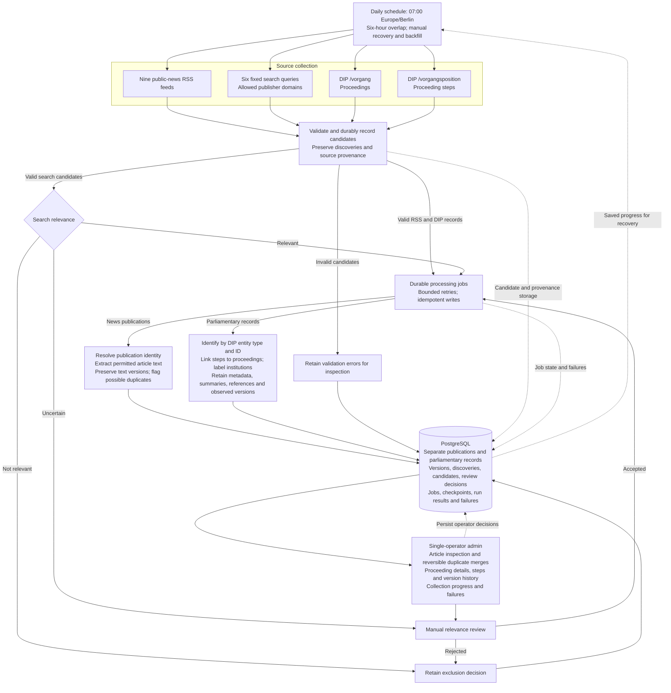

# Phase 1 collection architecture

Status: Phase 1 design and consolidated DIP amendment confirmed by the user; see [DIP design notes](dip-design-notes.md). This document describes the target architecture; the current implementation remains the synthetic RSS slice. Design confirmation does not authorize implementation or deployment.

## Deliverable

A fault-tolerant collection system combining targeted search agents, DIP parliamentary activity and public-news RSS feeds into validated, deduplicated and traceable source material. Publications and parliamentary records remain distinct domain entities. Persistent storage and a single-operator internal admin tool are included. No reader-facing product or English generation is included.

## Pipeline diagram

The diagram shows the confirmed target architecture. Each collector has independent progress and failure recovery; processing uses durable PostgreSQL-backed jobs.

DIP starts with a full import of the current electoral term, then scans update-time windows independently for each endpoint and selected scope. A checkpoint advances only after every page is durably stored. New terms are added explicitly while earlier selections remain monitored. Document-text retrieval, automatic article-to-proceeding links, and English explainer generation are deferred.

## Collection and processing

1. Schedule collection at 07:00 Europe/Berlin with six hours of overlap, retaining independent progress for each feed, search query, and DIP endpoint/scope.
2. Discover items through selected public-news RSS feeds, DIP proceedings and proceeding steps, and six fixed German search queries restricted to allowed publisher domains. Search assesses relevance and records reasons; configured RSS items and in-scope DIP records are included without relevance filtering.
3. Validate and durably record candidates and distinct discovery encounters. Invalid candidates remain inspectable. Uncertain search relevance goes to manual review.
4. Process with PostgreSQL-backed jobs. Normalize metadata and identify publications through publisher-scoped identifiers or resolved article URLs. Identify DIP proceedings and steps separately by source, entity type, and API ID, retaining parent relationships. Conflicting identities must remain inspectable rather than force a merge.
5. For news publications, where source permissions allow, fetch the directly linked resource and extract HTML article text. Preserve metadata and the original URL when extraction fails; unsupported formats do not require document-chain traversal or PDF extraction. For DIP, retain structured metadata, available summaries, steps, and document references; linked document-text retrieval is deferred.
6. Resolve any identity information obtained during extraction before final storage. Preserve text changes as versions under the same publication; title similarity alone only flags a possible duplicate.
7. Persist publications, allowed text versions, parliamentary records and their changed states, discoveries, run results, review decisions, and processing state in PostgreSQL. Retries and repeated runs must be idempotent; unchanged observations do not create additional versions.

New discovery encounters in genuinely new runs remain traceable; replaying the same run must not duplicate encounters. Retain the source and query scope for API encounters as well as feed/search provenance. Publication or document dates, source update timestamps, discovery times, and version observation times serve different purposes and must not be conflated. An updated parliamentary record is not by itself evidence of a new parliamentary development.

## Initial inputs

RSS selections: the nine public-news feeds in the [feed catalog](phase-1-feed-catalog.md): Tagesschau all updates and eight Deutschlandfunk feeds. DIP replaces the 25 previously selected Bundestag RSS feeds. Exact news endpoints and formats require live validation. All valid configured feed items remain eligible without relevance filtering. DW and state-parliament collection are deferred.

DIP selections: use `/vorgang` and `/vorgangsposition`, initially importing all proceeding types for the full current electoral term and their steps. Retain all institutions returned, labeling steps as Bundestag, Bundesrat, Bundesversammlung, or Europakammer activity. New terms are added explicitly; previously included terms remain monitored. The initial import captures available states, not earlier unobserved revisions. DIP parliamentary records replace editorial Bundestag RSS coverage; they do not promise identical coverage.

Search subjects: politics/legislation, employment/economy, housing, healthcare, education, and immigration. Launch search domains are `tagesschau.de` and `deutschlandfunk.de`, enabling evaluation against RSS from the same publishers. The configurable allowlist can later include approved non-public publishers after that baseline evaluation. German and English content is accepted without translation.

Runtime, search provider, hosting, exact query wording, and bounded retry settings are delegated to implementation research. Document choices against free-tier availability and measured results; payment or scope changes require revisiting the choice with the user. Source permissions and live feed/extraction behaviour remain to be verified.

## Reliability and operations

- Use durable jobs, bounded retries, independent source failures, inspectable exhausted failures, and manual recovery/backfill.
- Recheck publications discovered in the previous three days, and older publications when rediscovered, subject to source permissions.
- For DIP, independently scan each endpoint by `aktualisiert` using fixed start/end windows and the six-hour overlap. Repeat unchanged query parameters through cursor pagination until the cursor stops changing. Advance the successful checkpoint only after all pages are durably stored. Article recheck rules do not limit parliamentary update collection.
- Resume missed windows from each collector's successful progress and report unresolved gaps. Verify initial-import handoff, timestamp boundaries, and live pagination behavior; do not assume cross-endpoint snapshot consistency or infer deletions from absent incremental results. Do not claim historical completeness from finite RSS feeds.
- Pause providers when free allowances run out, continue independent RSS work, and expose the limitation. No automatic paid usage is authorized.
- Begin locally; deploy collection and the admin tool to an always-on environment after validation and hosting comparison. Protect the deployed single-operator tool with Basic Auth over HTTPS.

## Internal admin

Inspect headlines, publisher, dates, extraction state, original links, run results, and failures. Review uncertain search relevance. Compare possible duplicates side by side, merge reversibly while preserving original records and provenance, or keep separate. Retain review decisions.

Provide a separate proceeding list and detail view showing available summary and status, institution-labeled steps, document references, retained versions, collection progress, and failures. Missing optional summaries or status must remain visible as absent data. Automatic linking of reporting to proceedings is deferred.

## Acceptance and future extensions

Acceptance criteria are recorded in [design notes](phase-1-design-notes.md#agreed-completion-criteria), including seven scheduled runs, recovery and idempotence checks, a 30-item manual sample, and measured search contribution/usage. [DIP verification criteria](dip-design-notes.md#verification-criteria) add initial import, multi-page recovery, independent step updates, version retention, and term-transition checks.

English explainers are future downstream consumers of versioned source material. Coverage of all 16 state parliaments is a future collection extension. The News Gap Agent, event clustering, embeddings, semantic search, and reader-facing features are outside Phase 1.

Source permissions must be checked before retention is enabled; where unresolved, retain only permitted metadata and links. Validate DIP authentication, usage terms, limits, and live behavior before collection; the OpenAPI schema does not establish reuse permission. PostgreSQL and text-version decisions are recorded in [ADR 0002](adr/0002-postgresql-for-storage-and-jobs.md) and [ADR 0001](adr/0001-preserve-publication-versions.md); the parliamentary record decision is captured in [ADR 0004](adr/0004-parliamentary-records-and-versions.md).
