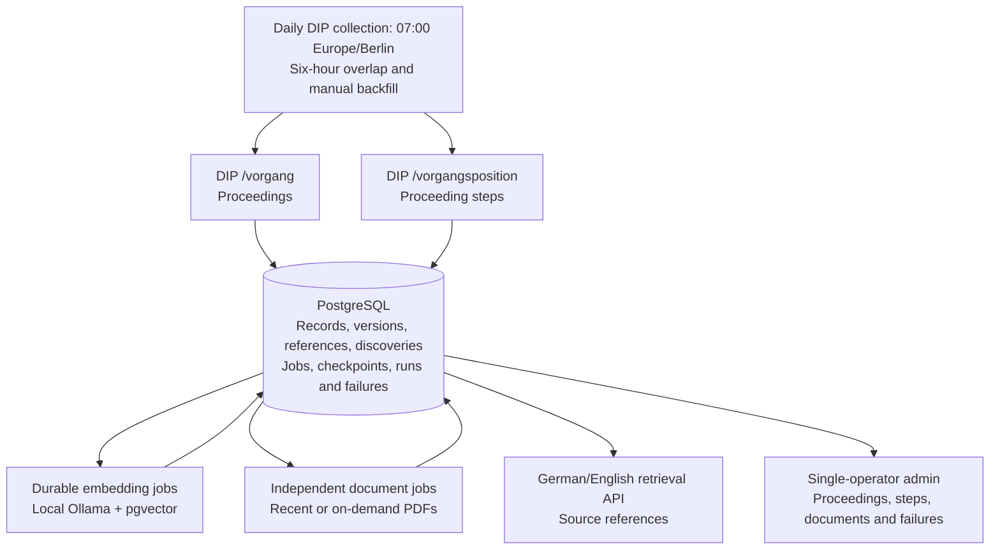

# Phase 1 parliamentary collection architecture

Status: accepted target after the [DIP-only pivot](adr/0007-dip-only-parliamentary-collection.md). This describes the intended architecture. The current runtime still exposes news collection and inspection paths; their removal and data cleanup are follow-up work.

## Deliverable

Collect and preserve parliamentary proceedings (`/vorgang`), proceeding steps (`/vorgangsposition`), and their linked document references from DIP. Provide an internal operator view and German/English semantic retrieval over current record text and processed PDFs. Future English explainers use proceeding dossiers and cited DIP evidence. Editorial news feeds, news search, article extraction, and news-to-proceeding linking are outside the target.

The selected electoral terms cover all proceeding types and the institutions returned by DIP, including Bundestag, Bundesrat, Bundesversammlung, and Europakammer. Call this parliamentary activity; do not imply that every record is a Bundestag action or that DIP covers all German government activity.

## Pipeline

DIP metadata and references are committed before the corresponding checkpoint advances. Embedding and PDF jobs run independently so model or document failures do not block source collection. News tables and routes still present in the runtime are legacy paths, not part of this target flow.

## Collection and processing

1. Initially import the full current selected electoral term in nonlocal environments. Local imports cap unique proceedings at 1,000 across runs, taking the first records encountered through cursor pagination and continuing to sync them; DIP does not specify result ordering. Import their associated steps. Add future terms explicitly and continue monitoring earlier selected terms.
2. Scan `/vorgang` and `/vorgangsposition` independently by source update time (`aktualisiert`), using fixed windows, six hours of overlap, unchanged page filters, and separate checkpoints per endpoint and selected scope. Advance a checkpoint only when all pages are durably stored. A source update may be a correction, not a new parliamentary event.
3. Identify each proceeding and step by DIP entity type and API ID. Retain observed changed states, source and observation times, scope, run, and discovery provenance. Link steps to proceedings through `vorgang_id`; retain missing-parent references for inspection.
4. Store `fundstelle` document references from steps, including available ID, document number, PDF URL, and document date. Do not fetch PDFs in the collection transaction. Queue PDFs dated within the preceding 14 days for independent processing; an on-demand request returns metadata and the source URL immediately and raises priority. Cache fetched variants by document ID and byte hash, extract page text with PyMuPDF, and retain page provenance.
5. Embed the latest proceeding title/summary, step text, and processed PDF pages with local Qwen3-Embedding-0.6B and PostgreSQL pgvector. Keep historical record versions, but exclude old versions from retrieval. Return source references for German and English queries; generated answers and the reader interface are later work.

## Reliability and operations

- Persist records, discoveries, jobs, attempts, checkpoints, run results, and failures in PostgreSQL. Replays must be idempotent, and exhausted work must be inspectable and retryable.
- Keep DIP import, record embedding, and PDF processing independent. Verify pagination recovery, bootstrap-to-incremental handoff, timestamp boundaries, missing parents, and term transitions. The six-hour overlap does not guarantee capture of arbitrarily delayed updates, and an absent incremental result does not prove deletion.
- Label institution-specific steps and keep document date, source update time, and observation time distinct. The initial import captures available states, not revisions that were never observed.
- Protect deployed admin access with Basic Auth over HTTPS. Daily DIP collection runs as `scripts/run-dip.ts` under a Render cron service; deploying it is the remaining follow-up, not new collector design.

## Source use and transition

The [DIP terms](https://dip.bundestag.de/documents/nutzungsbedingungen_dip.pdf) permit broad use of API and extracted PDF data but require the source “Deutscher Bundestag/Bundesrat – DIP” for distribution, additional document identification when reproducing official works, and marking changes. Original PDF works have separate reproduction rules, and the terms do not guarantee the absence of third-party rights. Keep provenance and source links with retrieved evidence and future explainers. Audit the current runtime's shorter DIP attribution label before publishing outputs.

Existing news records remain for internal inspection during the transition. [Issue #42](https://github.com/rotimi-babalola/news-intelligenz/issues/42) tracks later removal of RSS/search ingestion, article extraction, and news-only UI; export or backup of news data; and a reviewed migration that removes news-only tables while preserving DIP records and shared job state. Historical feed research and the original [design interview](phase-1-design-notes.md) record the earlier plan, not current acceptance criteria.

## Acceptance

Use the [DIP verification criteria](dip-design-notes.md#verification-criteria): selected-term import, multi-page recovery, independent step updates, version and provenance retention, term transitions, latest-version multilingual retrieval, lazy PDF processing, and inspection of failures. Demonstrate seven consecutive scheduled DIP runs once scheduling exists; verify persisted recovery and a manually reviewed sample of proceedings, steps, and linked documents. Historical RSS/search metrics, article review, and news extraction are excluded.

The record/version boundary is in [ADR 0004](adr/0004-parliamentary-records-and-versions.md), multilingual retrieval in [ADR 0005](adr/0005-local-multilingual-dip-retrieval.md), and future proceeding dossiers in [ADR 0006](adr/0006-proceeding-centric-explainers.md).
